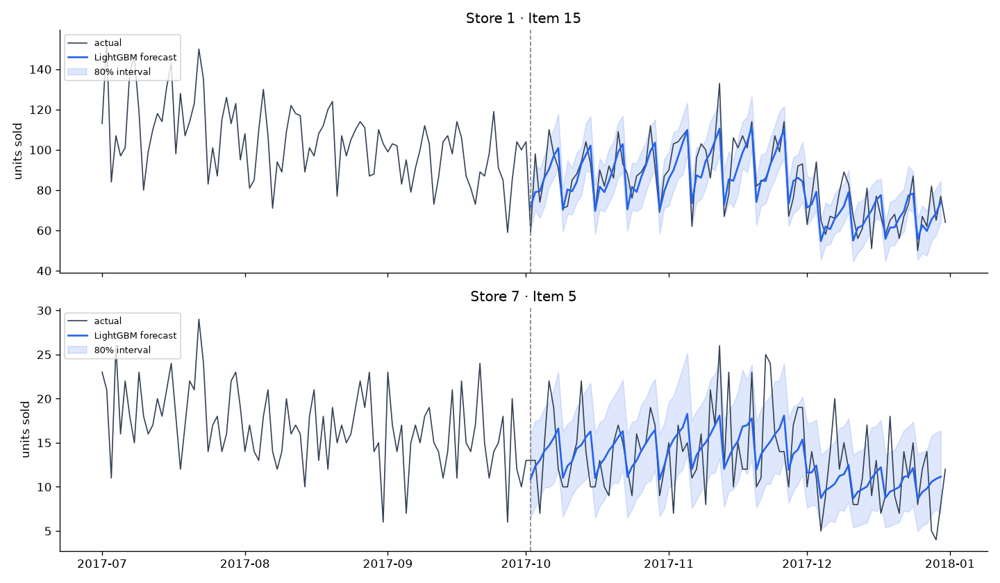
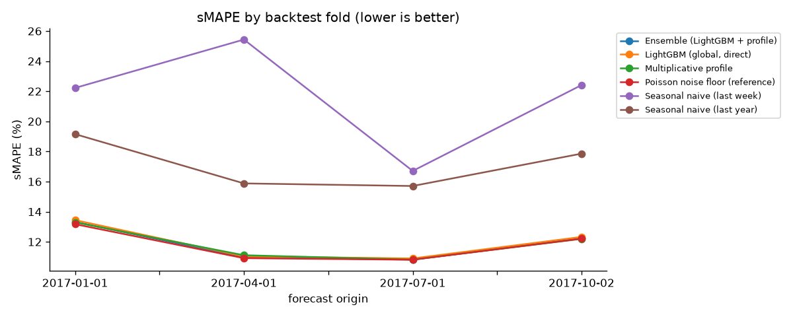
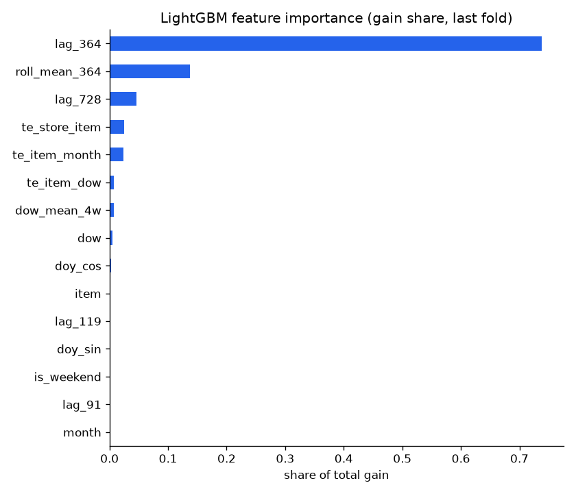

# Retail Demand Forecasting — 90-Day Horizon, 500 Series


 

Forecasting daily unit sales **90 days ahead** for **50 items × 10 stores (500 time series,
913k rows, 2013–2017)** — the planning horizon a retailer needs for purchasing and staffing.

The project compares statistical baselines against a **single global LightGBM model** using a
**rolling-origin backtest** (4 forecast origins through 2017), adds **probabilistic forecasts**
(80% prediction intervals), and checks how close we get to the **theoretical noise floor**.

## Results — mean over 4 backtest folds (each = 45,000 forecasts)

| Model | sMAPE | WAPE | MAE (units) | Bias | 80% PI coverage |
|---|---|---|---|---|---|
| *Poisson noise floor (reference)* | *11.78%* | *10.21%* | *5.93* | — | — |
| **Ensemble (LightGBM + profile)** | **11.84%** | **10.28%** | **5.96** | +0.2% | — |
| Multiplicative profile | 11.86% | 10.30% | 5.98 | +0.8% | — |
| LightGBM (global, direct) | 11.93% | 10.38% | 6.01 | −0.4% | **78.9%** |
| Seasonal naive (last year) | 17.15% | 14.73% | 8.54 | −3.6% | — |
| Seasonal naive (last week) | 21.70% | 19.61% | 11.44 | −3.0% | — |



### Key findings
1. **31% lower error than the standard seasonal-naive benchmark** (sMAPE 11.8% vs 17.2%), and
   consistent across all four folds.
2. **We are at the noise floor.** If sales are Poisson around the true mean, even a *perfect*
   forecast would score ~11.78% sMAPE. The ensemble is within **0.06 points** of that — remaining
   error is irreducible day-to-day randomness, not model weakness. Knowing when to *stop* tuning is
   as important as tuning.
3. **A well-built classical baseline is nearly as good as gradient boosting** here, because demand is
   driven by stable multiplicative store × item × weekday × season effects. LightGBM still adds value:
   it learns those effects automatically, produces **calibrated intervals** (78.9% empirical coverage
   for a nominal 80%), and the ensemble of both is the best model.
4. **Bias is near zero** (< 1%) for the top models — important because systematic over-forecasting
   means excess stock and under-forecasting means stock-outs.



## Methodology
- **Direct multi-horizon model:** every lag / rolling feature is at least 91 days old, so all 90 days
  are predicted at once — no recursive error compounding and **no leakage** (enforced by a unit test
  that tampers with future sales and asserts features don't change).
- **Global model:** one LightGBM across all 500 series (store and item as categorical features)
  shares strength between series; Tweedie objective suits non-negative count data.
- **Features:** calendar (weekday, month, cyclical day-of-year), lags 91–728 days, rolling means/std,
  exponentially-weighted means, and store/item seasonal profiles computed on the training window only.
- **Uncertainty:** separate quantile models (α = 0.1, 0.9) give an 80% prediction interval;
  coverage is evaluated on held-out data.
- **Rolling-origin evaluation:** 4 origins (Jan, Apr, Jul, Oct 2017), each training only on data
  before the origin and forecasting the next 90 days.



## Run it
```bash
pip install -r requirements-dev.txt && pip install -e .
python -m forecast.backtest   # ~5 min on a laptop; downloads data on first run
pytest -q                     # 6 tests incl. leakage test
```

## Structure
```
src/forecast/
├── features.py    # calendar, lag, rolling and profile features (leak-free)
├── baselines.py   # seasonal naive (week/year), multiplicative profile
├── metrics.py     # sMAPE, WAPE, MAE, bias, interval coverage
└── backtest.py    # rolling-origin backtest, LightGBM + quantile models, figures
tests/test_forecast.py
```

## Data
[Store Item Demand Forecasting Challenge](https://www.kaggle.com/c/demand-forecasting-kernels-only)
(Kaggle) — 5 years of daily sales for 50 items in 10 stores.
